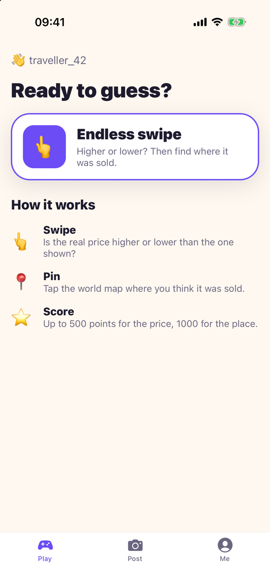
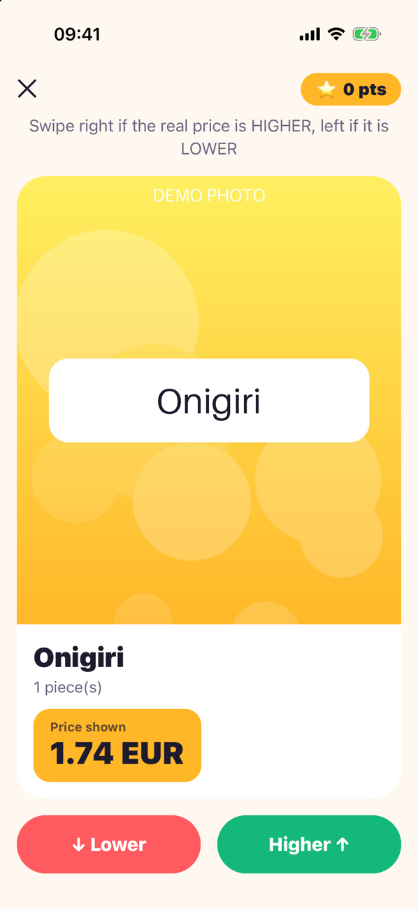
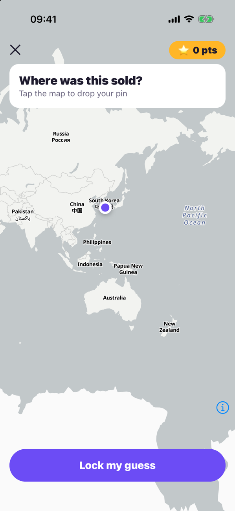
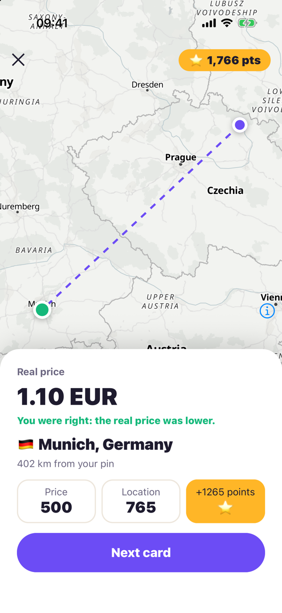
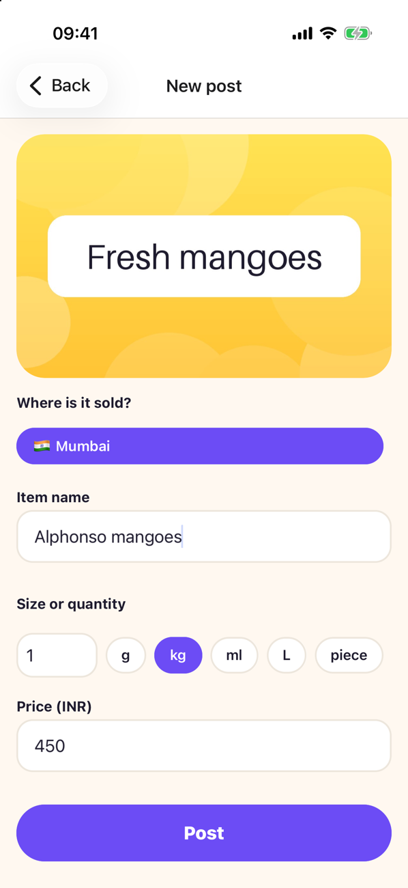
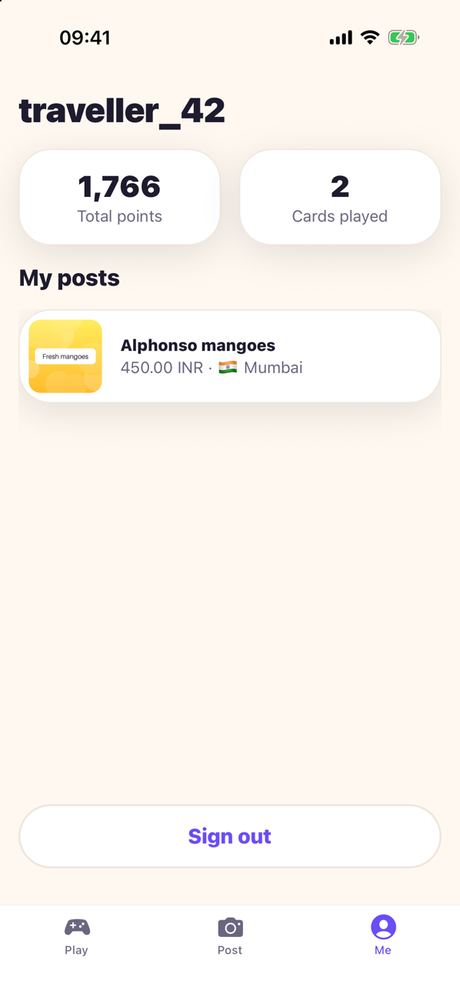
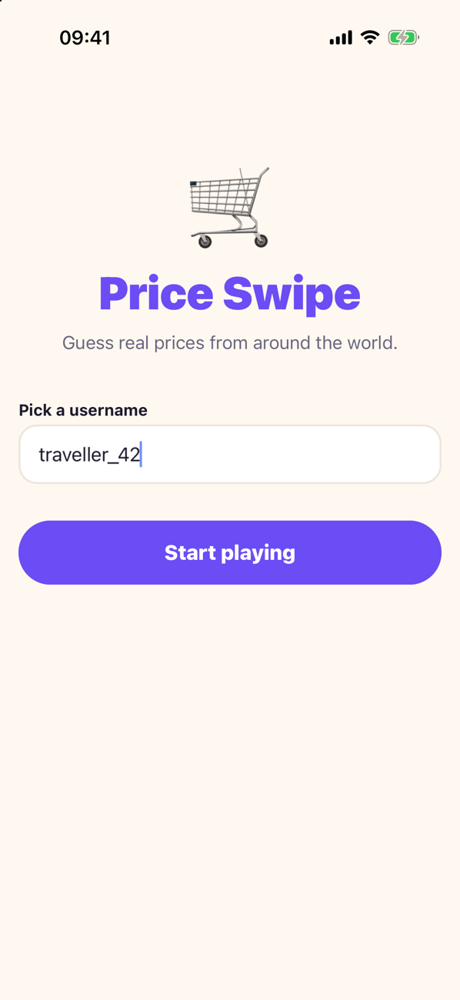

# Price Swipe

A mobile game about real prices around the world. You see a product photo with a price
and guess two things:

1. **Higher or lower?** Is the real price higher or lower than the one shown? Swipe right or left.
2. **Where?** Drop a pin on the world map where you think it was sold.

Then the answer is revealed: real local price, the city, how far your pin was, and your points.
Players post their own product photos (with the local price), and those become cards for everyone else.

<p align="center">
  
  
  
  
</p>
<p align="center">
  
  
  
</p>

> This repository is a **small demo version** of a larger personal project. It keeps the core
> game and posting; see [What the full app adds](#what-the-full-app-adds).

## Tech stack

| Part | Tools |
| --- | --- |
| iPhone app | React Native 0.86, Expo SDK 57, Expo Router, Reanimated + Gesture Handler (swipe), MapLibre (map), TypeScript |
| Backend | Python, FastAPI, SQLAlchemy 2, SQLite, Pillow |

## How the scoring works

- **The shown price carries no hint.** The server multiplies the real price by a random factor:
  50% of the time from `[0.50, 0.85]` (answer: *higher*), otherwise from `[1.15, 2.00]`
  (answer: *lower*). The factor is drawn uniformly on a **log scale**, so "half" and "double"
  are equally likely.
- **Price points:** 500 for a correct swipe.
- **Location points:** `1000 × exp(−distance / 1500 km)`, with the great-circle (haversine) distance.
  Pin on the city = 1000, 500 km away = 717, 1500 km = 368.
- **No cheating from the app:** a card sent to the phone has only the photo, name, size and
  shown price. The real price and city stay on the server (a "ticket") until the guess is sent.
- Prices are compared in euros using fixed demo exchange rates.

## Project layout

```
backend/
  app/main.py      API endpoints (sign-in, cards, guess, cities, post item, me)
  app/game.py      game rules: shown price, distance, points (pure functions)
  app/models.py    database tables
  app/seed.py      demo cities and 20 demo items (generated placeholder photos)
  tests/           a few tests for the rules and one full game round
mobile/
  src/app/         screens (Expo Router: one file = one screen)
  src/components/  SwipeCard, GuessMap, small UI kit
  src/lib/         API client, sign-in state, formatting, theme
```

## Run it locally (macOS + iOS Simulator)

You need [uv](https://docs.astral.sh/uv/), Node.js 20+, and Xcode with an iOS 26 simulator.

**1. Backend** (creates the SQLite database and demo items on first start):

```bash
cd backend
uv run uvicorn app.main:app --reload
```

API docs: http://localhost:8000/docs. Reset the demo data by deleting `backend/priceswipe.db` and `backend/media/`.

**2. iPhone app** (in a second terminal):

```bash
cd mobile
npm install
npx expo run:ios
```

Pick any username to sign in. To test on a real phone, copy `mobile/.env.example` to
`mobile/.env.local` and set `EXPO_PUBLIC_API_URL` to your computer's local IP.

**Tests:** `cd backend && uv run pytest`

Only tested on iOS. The map uses free [OpenFreeMap](https://openfreemap.org) tiles
(© OpenStreetMap contributors).

## What the full app adds

The private full version also has: e-mail code sign-in and age rules, a Daily 5 mode with
leaderboards, 1-vs-1 duels, local AI moderation of posted photos, automatic blurring of faces,
car plates and price tags, price plausibility checks, live exchange rates, reports and blocks,
and a React admin panel for reviewing posts.

## License

[MIT](LICENSE)
